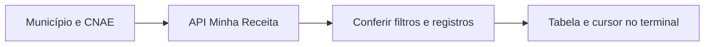
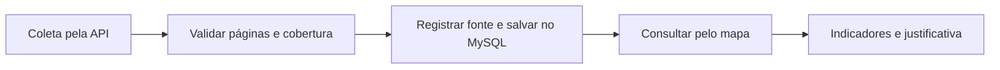
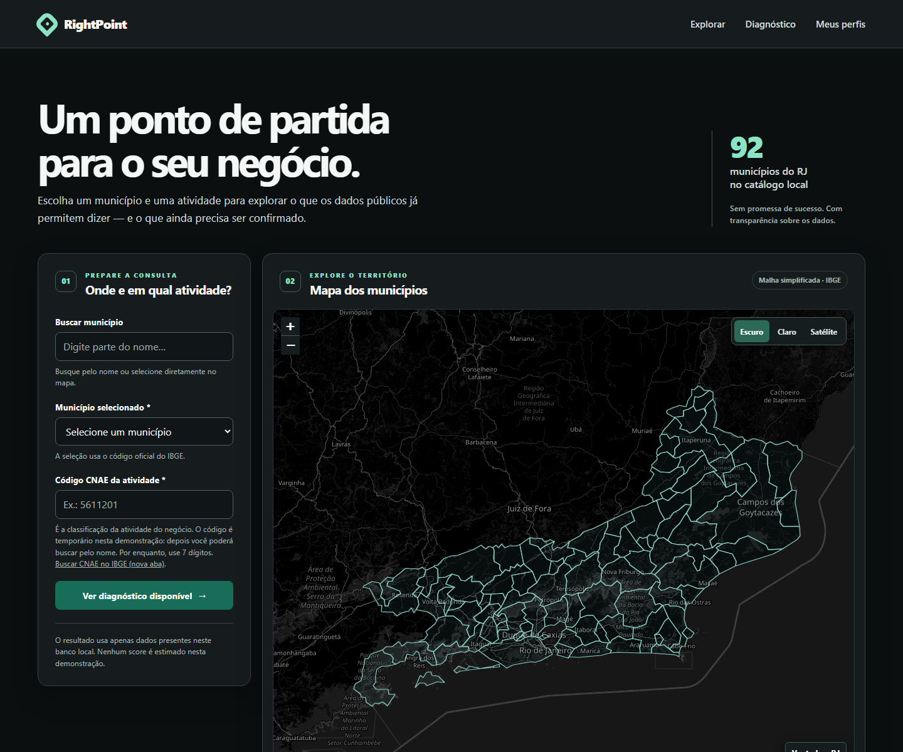

# RightPoint — roteiro para a apresentação

Atualizado em 05/11/2026. Material de apoio para os slides da professora; ampliar aos poucos, com frases curtas e exemplos reais do projeto. **Implementado**, **em teste** e **planejado** são estados diferentes.

**Integridade reforçada — 05/11:** o indicador por habitante exige população IBGE/Censo 2022 em pessoas e com recorte identificado. Outra fonte ou unidade não é usada silenciosamente; indisponibilidade não vira zero. Testes isolados verificam essas condições e a página com catálogo vazio/preenchido, sem depender do banco pessoal. Essa proteção técnica não valida a hipótese comercial ou os pesos.

**Etapa mais recente — diagnóstico compacto e estudo dos pesos:** nota/fatores/quatro indicadores em destaque; fórmula, fontes e limitações em detalhes expansíveis, mantendo referência CNPJ adotada e dados originais desconhecidos. Comando de sensibilidade implementado para três cenários nos quatro CNAEs/92 municípios, sem mudar o 50/50 da aplicação. Restaurantes: 30/70 alterou 90/92 posições, máximo 39 em relação à base; isso mostra dependência dos pesos, não validade de uma alternativa. [Procedimento](./procedimentos/sensibilidade-score.md) e [relatório completo](./analises/sensibilidade-score-2026-11-04.md). Suíte 220 testes/1.154 asserções; banco real preservado antes/depois do comando. Próximo passo: revisar interpretação com grupo e avaliar nova referência populacional como cenário próprio.

**Estado atual — score experimental implementado em 04/11:** banco com 92 populações e 92 rendas de 2022, quatro CNAEs/92 municípios na fotografia CNPJ assumida como 2026 por decisão do usuário. Método 50/50 de renda relativa e menor oferta registrada por habitante, posições percentuais/empates médios, versão identificada, conjunto completo e bloqueio com motivos quando insuficiente. Metadados originais CNPJ continuam NULL. Navegador: Maricá/restaurantes 50,0; Barra Mansa 59,3. Validação: 210 testes/1.099 asserções; testes não comprovam eficácia comercial. [Guia com fórmula, exemplos, sensibilidade e fala](./decisoes-arquiteturais/001-score-piloto-rj.md). Histórico/exportação e população estimada ainda planejados. Os registros datados de preparação a seguir são históricos e não devem ser apresentados como pendências atuais de renda/score.

**Demonstração preparada — 03/11:** o usuário carregou o lote RJ neste banco. Leitura posterior confirmou 92 coletas/soma 39.423, igualdade de contagens/controles com o JSON e piloto preservado: 93 linhas de histórico. HTTP 200: Barra Mansa com população 169.894/2022 e contagem 308; Maricá com 197.277/2022 e 620. Fonte, consulta mais recente e score NULL conferidos; capturas/relato posteriores validaram os exemplos descritos abaixo. Na preparação, 25 testes/159 asserções do importador e da consulta passaram em memória. Nenhuma carga repetida ou consulta BigQuery pelo agente. Os relatos de 28/10 abaixo são históricos do ambiente então verificado; bancos não acompanham o Git. O enunciado original disponível é de modelagem do 1º bimestre; exigências posteriores de implementação/apresentação ainda precisam ser confirmadas.

**Primeiro indicador calculado — 04/11:** oferta registrada por 10 mil habitantes = contagem / população × 10.000. Serviço no backend, estados de ausência/invalidade/zero e duas casas na interface. Navegador Apache: Maricá 31,43 e Barra Mansa 18,13 para restaurantes; outro CNAE sem coleta permaneceu indisponível. Fontes/períodos separados, comparação exploratória, sem saturação/score inventados. Suíte final 147 testes/804 asserções. URLs de subpasta e cache dos assets corrigidos; resultado sem overflow medido em 375 px. Próxima etapa: investigar renda municipal.

**Renda municipal preparada — 04/11:** média nominal mensal domiciliar por pessoa, Censo 2022/amostra, tabela 10295/variável 13431, totais dos 92 municípios. Fonte oficial e unidades conferidas; exemplos R$ 1.407,80 em Barra Mansa e R$ 1.707,99 em Maricá, de 2022. Importador com simulação/transação e leitura local/API/tela preparados; carga real ainda pendente. Suíte 179 testes/954 asserções; nenhuma renda gravada pelo agente. UI preenchida testada com resposta simulada. Renda não é salário individual, gasto comercial ou fator de score aprovado. [Procedimento](./procedimentos/renda-municipal-rj.md).

## 1. Problema e objetivo

### Como explicar referências de anos diferentes — planejamento de 04/11

- **Período do dado, publicação e consulta são datas diferentes.** Uma coleta em 2026 pode conter renda medida em 2022; data do job CNPJ não confirma a competência da base.
- População atual da consulta: Censo 2022. Estimativas 2024/2025/2026 consultadas, mas não integradas. Renda municipal carregada: julho/2022, amostra. CNPJ: extraído em 03/11/2026, assumido como 2026 pelo usuário somente para o experimento; período/versão na fonte desconhecidos.
- Para comparar municípios, a proposta exige a mesma fonte/conceito/referência de cada fator em todas as cidades do conjunto. Entre fatores, avaliar e justificar defasagem e adequação à finalidade; mostrar anos diferentes não basta para validar uma nota.
- **Estado atual:** índice experimental implementado, com premissa explícita, conjunto uniforme, fatores/pesos e motivos quando bloqueado. Competência CNPJ/cobertura não confirmadas e ausência de validação comercial impedem tratá-lo como probabilidade ou orientação confiável. Aprovação acadêmica definitiva continua pendente.
- Exemplo aritmético: Maricá com os mesmos 620 restaurantes passa de 31,43 por 10 mil habitantes (população 2022) para 29,15 no cenário com estimativa 2026. A diferença vem do denominador; não demonstra fechamento de empresas ou melhora comercial. Esse cenário não foi aplicado à tela.
- Corrigir renda por inflação muda sua expressão monetária; não mede a renda efetivamente recebida em outro ano. Renda estadual recente também não substitui a municipal.
- Futuro índice: explicitar fatores, referências, pesos, conjunto comparado e versão; avaliar sensibilidade às escolhas e preservar análises antigas. Não transformar defasagem em desconto arbitrário da nota ou percentual inventado de confiança.

Texto de fala sugerido:

> As fontes públicas têm calendários diferentes. Nesta versão usamos população e renda de 2022 e assumimos 2026 para este lote CNPJ, sem alterar a procedência original. Comparamos os 92 municípios com os mesmos recortes por fator. Metade da nota vem da renda relativa e metade da menor oferta registrada por habitante. É um índice experimental de contexto, não uma fotografia integral de 2026 ou porcentagem de sucesso. Os fatores, pesos e limitações aparecem na tela.

Roteiro de estudo, exemplos, condições e etapas futuras: [compatibilidade temporal do diagnóstico](./planos/compatibilidade-temporal-diagnostico.md).

**Ampliação técnica implementada — 03/11:** novo comando valida/simula quatro CNAEs e separa município/atividade; pares ausentes não viram zero. Gravação exige fotografia conferida por hash e instante UTC; transação preserva histórico e impede sobrescrita divergente. Suíte completa: 126 testes/701 asserções. Usuário executou a query e exportou o JSON; simulação real aprovou 368 pares, com 92 municípios por CNAE e somas 39.423/25.188/8.992/102.086. Job conferido por captura em 04/11: SQL preparada, início `2026-11-03 20:41:41` UTC e 3,81 GB processados/faturados na interface. Carga executada pelo usuário: 368 novas coletas; leitura confirmou igualdade ao JSON e 93 anteriores preservadas, total 461 linhas históricas. Oito consultas diretas ao controller em Barra Mansa/Maricá aprovadas com nova coleta e score NULL; novos recortes ainda sem conferência visual. Período/versão NULL; job não comprova competência da fonte. Renda/indicadores derivados/score continuam planejados. [Procedimento dos perfis](./procedimentos/contagens-perfis-piloto.md).

**Piloto ampliado em planejamento — 03/11:** usuário escolheu restaurantes, padarias e barbearias. Candidatos: 5611201; 1091102/4721102; 9602501. O código de barbearias também inclui cabeleireiros/manicure/pedicure; não é contagem exclusiva. Somente restaurantes têm carga CNPJ. [Critérios propostos](./planos/criterios-diagnostico-piloto.md): oferta registrada por habitante, renda a investigar e índice experimental a testar; não implementados nem fórmula final aprovada.

Conferência visual de 03/11: captura confirmou Barra Mansa/5611201 com população 169.894/2022, contagem 308, fontes/datas, referências desconhecidas e avisos. Usuário confirmou Maricá por relato. Outra captura mostrou Paty do Alferes/7490104 com população 29.619/2022 e contagem indisponível, sem inventar zero ou score. Esses exemplos não comprovam mobile ou todas as interações. Próxima etapa: definir as regras do primeiro diagnóstico e confirmar critérios/fórmula com grupo/professora. A coleta atual cobre apenas restaurantes; catálogo CNAE não equivale a contagem disponível para toda atividade.

- Problema: reunir informações dispersas para avaliar onde abrir um negócio.
- Público: empreendedor interessado em um município ou regiao especifica e uma atividade econômica.
- Recorte inicial: **92 municípios do RJ**, identificados pelo código IBGE.
- CNAE identifica a atividade; CNPJ identifica o estabelecimento.
- Objetivo final: indicadores, concorrentes e justificativa; score orientativo somente após validar dados e fórmula.
- Base acadêmica: [minimundo](./contexto/minimundo.md). Não é garantia nem probabilidade estatística de sucesso.

## 2. Fontes: o que buscamos e como usamos

| Fonte / referência | Uso no RightPoint | Situação verificada |
| --- | --- | --- |
| [IBGE Localidades](https://servicodados.ibge.gov.br/api/v1/localidades/estados/33/municipios) | Código e nome dos municípios; ligação entre fontes | 92 municípios importados |
| [IBGE CNAE](https://servicodados.ibge.gov.br/api/docs/CNAE?versao=2) | Catálogo de atividades e busca por nome/código | 1.332 códigos importados; versão da classificação ainda a confirmar |
| [IBGE Censo 2022 / agregado 4714](https://sidra.ibge.gov.br/tabela/4714) | População residente, variável 93, unidade Pessoas | 92 valores em 92 municípios neste computador; Barra Mansa 169.894 e Maricá 197.277 na consulta. Não são população atual |
| [IBGE Censo 2022 / tabela 10295](https://sidra.ibge.gov.br/tabela/10295) | Renda nominal média mensal domiciliar por pessoa, variável 13431, amostra/totais | 92 valores carregados; Maricá R$ 1.707,99 e Barra Mansa R$ 1.407,80. Fator do experimento; não é renda atual ou salário individual |
| [IBGE Malha Municipal](https://www.ibge.gov.br/geociencias/organizacao-do-territorio/malhas-territoriais/15774-malhas.html) | Limites dos municípios selecionáveis no mapa | Malha simplificada consultada e validada por código; edição a confirmar |
| [Minha Receita](https://docs.minhareceita.org/como-usar/#busca-paginada), serviço independente baseado em dados públicos de CNPJ | Buscar estabelecimentos por município e CNAE principal | API em teste; comando com até 3 páginas e cursor automático; CNPJ ainda não importado |
| [Mapa de Empresas](https://www.gov.br/empresas-e-negocios/pt-br/mapa-de-empresas/painel-mapa-de-empresas) | Candidato a total de CNPJs ativos por município e atividade | Filtro pela subclasse CNAE exata e exportação ainda a conferir; não fornece lista individual validada |
| [OpenCNPJ — opencnpj.org](https://opencnpj.org/) | SQL no BigQuery → JSON agregado → MySQL → diagnóstico/score experimental | Fotografia atual com 368 pares nos quatro CNAEs/92 municípios; 461 coletas históricas. CNPJ 2026 assumido pelo usuário, competência/versão originais NULL e cobertura comercial não comprovada |
| [Receita Federal, arquivos abertos](https://www.gov.br/receitafederal/pt-br/acesso-a-informacao/dados-abertos/cadastros/cnpj) / [Casa dos Dados](https://docs.casadosdados.com.br/pesquisa-avan%C3%A7ada-de-empresas-16579062e0) | Alternativas para dados individuais de estabelecimentos | Receita exige processar arquivos grandes; Casa exige chave e saldo. Nenhuma integrada |
| [OpenStreetMap](https://www.openstreetmap.org/copyright) / [Esri World Imagery](https://server.arcgisonline.com/ArcGIS/rest/services/World_Imagery/MapServer) | Fundo cartográfico claro/escuro e satélite | Apoio visual; não calculam o score. Mapbox não foi integrado |
| ANP, INMET e investimentos públicos | Possíveis indicadores complementares | Candidatas; sem integração ou uso no score. Referências em [FONTES_DADOS.md](./FONTES_DADOS.md) |

## 3. Estratégia de integração

**CNPJ hoje — experimento executado pelo terminal:**

- A API recebe filtros e retorna os CNPJs; não precisamos conhecê-los antes da busca.
- Cada página traz até 2 registros neste exercício. O cursor permite continuar; repetir a consulta sem cursor retorna a primeira página.
- Conferimos campos, CNPJ textual preenchido, município, CNAE e repetidos entre páginas. O comando percorre até 3 páginas, mantendo os filtros e o cursor; não valida ainda formato/dígitos verificadores do CNPJ.
- Duas páginas pequenas foram comparadas em teste real, sem repetição observada nesses registros; isso não comprova cobertura completa.
- Timeout e HTTP 429 interrompem a tentativa. Na execução real com duas páginas, a primeira trouxe 2 registros e a segunda respondeu 429; não houve contagem completa. A busca paginada é experimental e pode ser limitada pelo próprio servidor. Uma amostra não representa o total de concorrentes.
- Comparação documental: o Mapa de Empresas pode servir ao total municipal após validar os filtros; dados individuais exigem outra fonte. A escolha da fonte e a regra de concorrência seguem pendentes.
- Paginação testada com respostas simuladas: teto de chamadas, cursor, duplicatas, fim antecipado e erros; confirmação do novo laço na API real ainda pendente.
- O leitor CSV foi um exercício de leitura e permanece como alternativa; os resultados atuais vieram da API.
- OpenCNPJ em avaliação: API documentada consulta um CNPJ conhecido; o teste de busca por município/atividade foi feito via **SQL no BigQuery**, não por essa API. Conferimos contrato, publicação, esquema e tamanho antes de adquirir dados. [Evidências](./FONTES_DADOS.md#opencnpj--avaliação-autorizada-em-27102026).
- Segurança de custo: estimar → definir teto de bytes → obter autorização → executar uma vez. `LIMIT` não limita a leitura; orçamento de alertas não bloqueia gastos do BigQuery. Custo efetivo ainda a conferir.
- Integração entre códigos **implementada para os 92 municípios do RJ**: configuração explícita Receita↔IBGE, preservando zeros iniciais; Parati/Paraty é exceção documentada. O vínculo usa códigos oficiais, nunca o ID interno fixo de outra máquina. `cnpj:verificar-municipio` verifica um par; `cnpj:verificar-contagens-rj` confere o lote inteiro, sem gravação. Não há associação por nome parecido.
- Arquivo local conferido em PHP: lista JSON completa, 10 CNPJs distintos, todos com UF RJ, CNAE principal `5611201`, situação `Ativa` e código Receita `5853`. Um CNPJ tem zero inicial: manter como texto. Não é total de concorrentes nem validação cadastral atual.
- Fluxo de amostra em teste: SQL BigQuery → baixar JSON → conferir formato, campos, filtros e duplicatas em PHP. Comando `cnpj:verificar-amostra` aprova 10 registros e rejeita duplicata fictícia. Testes adicionais adiados pelo usuário; dígitos verificadores, cobertura e termos dos dados pendentes. Essa amostra individual não foi importada; o agregado abaixo foi.

**Fluxo alvo para CNPJ — planejado, com atualização separada da consulta do usuário:**

Piloto implementado: [contagem agregada de Maricá/restaurantes](./procedimentos/contagem-cnpj-piloto.md), sem `LIMIT`: 620 registros, 620 CNPJs distintos, 0 ausentes. Fluxo realizado: **SQL BigQuery → JSON local → validação PHP → transação → MySQL**. Não são 620 cadastros individuais, nem prova de cobertura de todos os negócios reais.

No piloto do trabalho, a persistência foi conferida com uma linha em `contagens_estabelecimentos` e quantidade 620, vinculada a município, atividade e fonte. Comando simula por padrão; `--gravar` autoriza a escrita local. Repetir a mesma coleta não duplica nem atualiza o registro (**idempotência**). Fonte e data UTC registradas; período/versão desconhecidos ficam NULL.

- **Leitura implementada:** município + CNAE → coleta mais recente da fonte/critério do piloto → quantidade + procedência + avisos. A consulta só lê o banco local; não gera custo BigQuery a cada clique.
- **Sem coleta:** dado indisponível, não zero. Zero registrado não comprova ausência real de concorrentes. Método piloto exige conjunto completo e referências declaradas: Censo/renda 2022 e premissa CNPJ 2026. Fora dessas condições, score NULL com motivo.
- **Consulta combinada neste computador:** Barra Mansa (`3300407`) mostrou 169.894 pessoas do Censo 2022 e contagem 308 na base CNPJ; Maricá (`3302700`) mostrou 197.277 pessoas e contagem 620 para CNAE `5611201`. A rota devolve fontes, datas e avisos; a conferência visual no navegador ainda falta.
- **Validação:** HTTP real de Maricá retornou 620; suíte completa com 30 testes/117 asserções aprovada. Captura do usuário confirmou no desktop população, contagem, fontes/datas e avisos. Mobile e recorte sem coleta ainda precisam de conferência visual; navegador da ferramenta sem permissão para localhost.
- **Comparação municipal carregada neste computador:** [consulta agregada](./procedimentos/comparacao-cnpj-municipios-rj.md) trouxe 92 grupos RJ/5611201/Ativa, soma municipal 39.423 e ausentes 0. O MySQL contém 92 coletas; Maricá tem 620 e Barra Mansa 308. Job de 28/10/2026: 3,81 GB processados/faturados; instante UTC registrado, sem credenciais/IDs privados. Edição/competência continuam desconhecidas; a carga não comprova cobertura real nem gera score.
- **Rastreabilidade da publicação:** Detalhes da tabela conferidos: última modificação em 14/10/2026; descrição sem edição/competência. Data de consulta, modificação da tabela e período dos dados são conceitos diferentes. Referência desconhecida permanece NULL mesmo após a carga local; nenhuma nova consulta paga foi necessária.
- **Verificação em lote implementada:** arquivo → conferir contrato/filtros/contagens → resolver os 92 códigos → comparar nomes → tabela/soma/hash, sem gravar. Execução real aprovou 92 grupos e soma 39.423; verificador coberto pela suíte. A carga posterior foi conferida no MySQL deste computador e na rota demonstrativa para Maricá e Barra Mansa.

- Atualizações previstas: uma fonte por vez; frequência e retentativas a definir.
- A consulta demonstrativa já lê população e catálogos locais. A integração CNPJ seguirá essa separação se a fonte for validada.
- Nenhum conjunto parcial deve ser apresentado como cobertura completa. [Matriz e fluxo detalhado](./arquitetura/matriz-dados-diagnostico.md).

### Evolução proposta: análise por células H3

- H3 é um índice geográfico aberto desenvolvido para necessidades da Uber; agrupa pontos em células de diferentes resoluções. Não é uma fonte de população nem uma fórmula de sucesso. [Documentação oficial](https://h3geo.org/docs/).
- Ideia para o RightPoint: estabelecimentos localizados → células H3 → concentração e contexto por entorno → diagnóstico explicável. É proposta, não funcionalidade entregue.
- Requisitos: coordenadas verificadas e dados censitários intramunicipais compatíveis. População por célula pode exigir estimativa; maior detalhe no mapa não significa maior precisão.
- Preservar limites oficiais e fontes/datas; célula pode cruzar bairros/municípios. Não usar dados operacionais internos de segurança no protótipo. [Plano e fontes](./planos/analise-territorial-h3.md).

## 4. Ferramentas e responsabilidades

- **Importador em lote entregue:** validação compartilhada → conferir hash/job UTC → simular → `--gravar` → transação de fonte e 92 coletas. Repetição não duplica; divergência não sobrescreve; falha desfaz tudo. Piloto anterior preservado no banco do trabalho. **85 testes/447 asserções aprovados** na implementação; primeira carga deste lote no MySQL local conferida por contagens e rota, sem repetição da escrita pelo agente.

- **PHP / Laravel:** rotas, controllers, validação, models e comandos Artisan.
- **Blade, HTML, CSS e JavaScript:** página, formulários, pesquisa e interação.
- **Leaflet:** componente do mapa; as bases cartográficas vêm de outros fornecedores.
- **MySQL/MariaDB no XAMPP:** dados locais. **phpMyAdmin:** interface para consultar o banco.
- **VS Code, PowerShell, Git e GitHub:** desenvolvimento, comandos e continuidade entre computadores.
- **Codex:** apoio de orientação, revisão e partes da implementação; o sistema atual não usa IA para gerar o diagnóstico.

## 5. Como verificamos e importamos

Comandos executados dentro de `Right_Point/`, com o prefixo `php artisan`:

| Dado | Conferência sem gravação | Importação local |
| --- | --- | --- |
| Municípios | Validação incluída no importador | `ibge:importar-municipios-rj` |
| Atividades | `ibge:verificar-cnaes` | `ibge:importar-cnaes` |
| População 2022 | `ibge:verificar-populacao-rj` | `ibge:importar-populacao-rj` |
| Estabelecimentos | `cnpj:verificar-busca` | Ainda não implementada |
| Contagem agregada piloto | `cnpj:importar-contagem` | `cnpj:importar-contagem --gravar` |
| Lote agregado RJ | `cnpj:verificar-contagens-rj "caminho/do/lote.json"` e importador sem opção | `cnpj:importar-contagens-rj "caminho/do/lote.json" --gravar` — 92 coletas conferidas neste computador |

- **Migration** define a estrutura; **model** representa o acesso aos dados.
- Os importadores validam a resposta antes de gravar. **Transação:** desfaz a carga se a gravação falhar. **Upsert:** insere ou atualiza pela chave, evitando duplicar o mesmo dado.
- Conferências: sintaxe PHP, mensagens/retornos, contagens e códigos distintos no MySQL, consulta HTTP e respostas simuladas para erros e duplicatas.
- População registra município, fonte, período e data de coleta. Censo 2022 e data de importação são informações diferentes.
- Conferências anteriores no trabalho/escola: 92 municípios, 1.332 CNAEs e 92 populações. O Git transfere código e migrations; o banco de cada máquina precisa ser conferido.
- Exemplos e finalidade dos comandos: [COMANDOS.md](./COMANDOS.md). Evidências por etapa: [STATUS.md](./STATUS.md).

## 6. Caso de uso, regras e integridade

- **Caso de uso demonstrável:** empreendedor seleciona município no mapa/busca, escolhe atividade e consulta indicadores disponíveis; pode guardar um perfil no navegador.
- **Entrada:** código IBGE e CNAE. **Saída atual:** identificação, população e contagem agregada disponíveis, fontes/datas e avisos sobre recorte, referências e dados faltantes. Score NULL.
- **RN-001/002/003:** análise vinculada a atividade e região válidas.
- **RN-006/007/016 — proposta:** concorrentes ativos, no mesmo município e com CNAE principal exato; aguarda validação acadêmica.
- **RN-011/012/017/018:** explicar fatores e limitações; score orientativo apenas com mínimos e fórmula aprovados.
- **RI-003/007/010/015:** referência geográfica válida, unicidade de CNPJ quando armazenado, procedência e ausência de score com dados insuficientes. Ausência de dados não significa zero concorrentes.
- **Já no banco:** indicadores ligados a município/fonte por chaves estrangeiras e chave única de município + fonte + indicador + período. **Pendente:** tabela de estabelecimentos, validação completa do CNPJ e preservação de futuras análises históricas.
- Detalhes: [regras de negócio](./contexto/regras-de-negocio.md) e [restrições de integridade](./contexto/restricoes-de-integridade.md).

## 7. CRUD de perfis do negócio

- **Criar:** guardar nome, município, CNAE e observações.
- **Ler:** listar os perfis salvos e usar um perfil para preencher a consulta.
- **Atualizar:** editar o perfil e salvar as alterações.
- **Excluir:** remover um perfil após confirmação.
- Implementação atual: JavaScript + `localStorage`, no próprio navegador, sem login ou tabela MySQL de perfis. Não sincroniza entre computadores.
- Salvar/listar foi demonstrado por captura; edição/exclusão e outros fluxos visuais ainda precisam de conferência completa. CRUD compartilhado e autenticação continuam a definir.

## 8. Imagens e roteiro de demonstração

Imagem de referência de uma versão anterior, antes da busca de CNAE por nome; substituir por captura atual para os slides finais. Interface: RightPoint; limites: IBGE; base: [© OpenStreetMap contributors — ODbL](https://www.openstreetmap.org/copyright). Preservar os créditos nas imagens dos slides.

- Capturas a acrescentar: consulta com população/fonte, CRUD com dados fictícios e terminal com validação/paginação CNPJ.
- Ordem da demonstração: selecionar município → pesquisar atividade → consultar → salvar perfil → mostrar conferência da fonte.
- Antes da apresentação final: atualizar imagens, testar editar/excluir e revisar o que saiu de planejado para implementado.
- **Palavras-chave:** API, JSON, CNAE, CNPJ, código IBGE, cursor, validação, transação, upsert, integridade e rastreabilidade.
