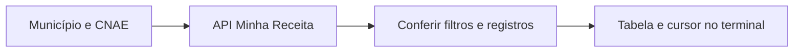
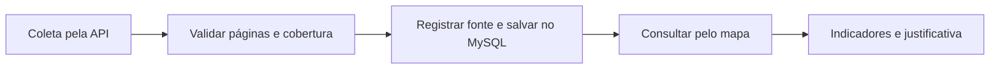
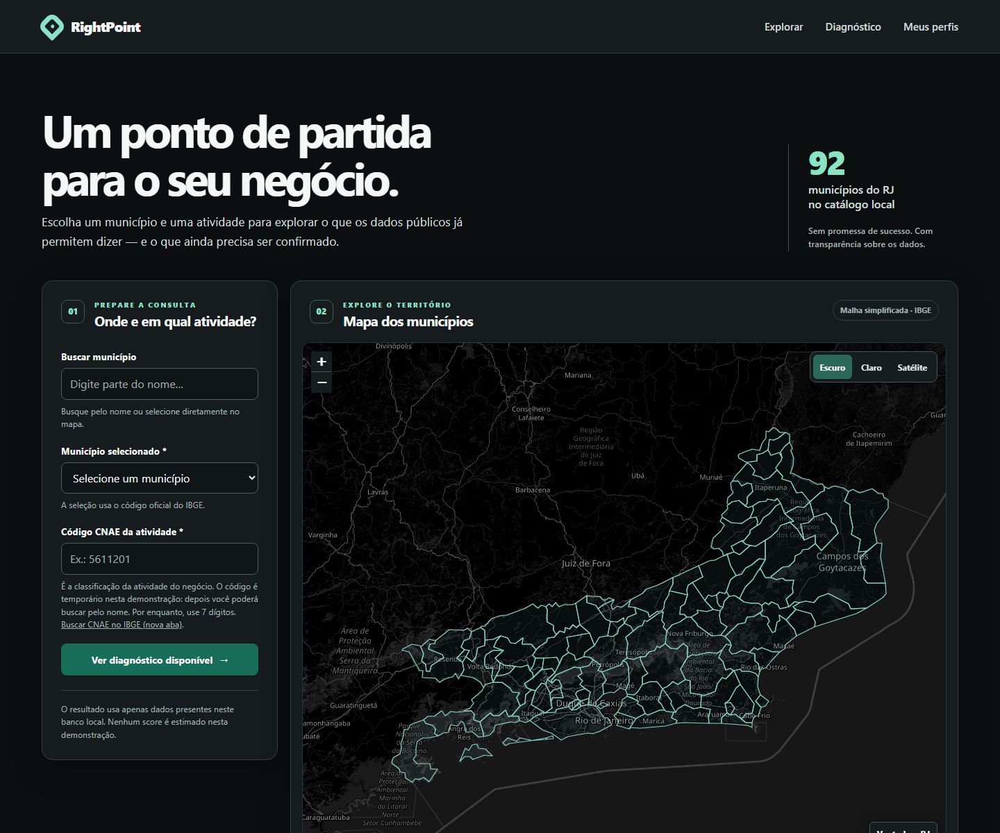

# RightPoint — roteiro para a apresentação

Atualizado em 28/10/2026. Material de apoio para os slides da professora; ampliar aos poucos, com frases curtas e exemplos reais do projeto. **Implementado**, **em teste** e **planejado** são estados diferentes.

## 1. Problema e objetivo

- Problema: reunir informações dispersas para avaliar onde abrir um negócio.
- Público: empreendedor interessado em um município ou regiao especifica e uma atividade econômica.
- Recorte inicial: **92 municípios do RJ**, identificados pelo código IBGE.
- CNAE identifica a atividade; CNPJ identifica o estabelecimento.
- Objetivo final: indicadores, concorrentes e justificativa; score orientativo somente após validar dados e fórmula.
- Base acadêmica: [minimundo](./contexto/minimundo.md). Não é garantia nem probabilidade estatística de sucesso.

## 2. Fontes: o que buscamos e como usamos

| Fonte / referência | Uso no RightPoint | Situação verificada |
| --- | --- | --- |
| [IBGE Localidades](https://servicodados.ibge.gov.br/api/v1/localidades/estados/33/municipios) | Código e nome dos municípios; ligação entre fontes | 92 municípios importados |
| [IBGE CNAE](https://servicodados.ibge.gov.br/api/docs/CNAE?versao=2) | Catálogo de atividades e busca por nome/código | 1.332 códigos importados; versão da classificação ainda a confirmar |
| [IBGE Censo 2022 / agregado 4714](https://sidra.ibge.gov.br/tabela/4714) | População residente, variável 93, unidade Pessoas | 92 valores no banco do trabalho e população de Maricá exibida; conferir banco da escola. Não são população atual |
| [IBGE Malha Municipal](https://www.ibge.gov.br/geociencias/organizacao-do-territorio/malhas-territoriais/15774-malhas.html) | Limites dos municípios selecionáveis no mapa | Malha simplificada consultada e validada por código; edição a confirmar |
| [Minha Receita](https://docs.minhareceita.org/como-usar/#busca-paginada), serviço independente baseado em dados públicos de CNPJ | Buscar estabelecimentos por município e CNAE principal | API em teste; comando com até 3 páginas e cursor automático; CNPJ ainda não importado |
| [Mapa de Empresas](https://www.gov.br/empresas-e-negocios/pt-br/mapa-de-empresas/painel-mapa-de-empresas) | Candidato a total de CNPJs ativos por município e atividade | Filtro pela subclasse CNAE exata e exportação ainda a conferir; não fornece lista individual validada |
| [OpenCNPJ — opencnpj.org](https://opencnpj.org/) | Contagem piloto via SQL no BigQuery → JSON → MySQL → consulta demonstrativa | Uma coleta com 620 CNPJs distintos ativos, CNAE principal `5611201`, Maricá/RJ; 0 ausentes. Reimportação sem duplicação conferida. Fonte/data disponíveis no resultado; versão/período desconhecidos e cobertura real não comprovada |
| [Receita Federal, arquivos abertos](https://www.gov.br/receitafederal/pt-br/acesso-a-informacao/dados-abertos/cadastros/cnpj) / [Casa dos Dados](https://docs.casadosdados.com.br/pesquisa-avan%C3%A7ada-de-empresas-16579062e0) | Alternativas para dados individuais de estabelecimentos | Receita exige processar arquivos grandes; Casa exige chave e saldo. Nenhuma integrada |
| [OpenStreetMap](https://www.openstreetmap.org/copyright) / [Esri World Imagery](https://server.arcgisonline.com/ArcGIS/rest/services/World_Imagery/MapServer) | Fundo cartográfico claro/escuro e satélite | Apoio visual; não calculam o score. Mapbox não foi integrado |
| ANP, INMET e investimentos públicos | Possíveis indicadores complementares | Candidatas; sem integração ou uso no score. Referências em [FONTES_DADOS.md](./FONTES_DADOS.md) |

## 3. Estratégia de integração

**CNPJ hoje — experimento executado pelo terminal:**

- A API recebe filtros e retorna os CNPJs; não precisamos conhecê-los antes da busca.
- Cada página traz até 2 registros neste exercício. O cursor permite continuar; repetir a consulta sem cursor retorna a primeira página.
- Conferimos campos, CNPJ textual preenchido, município, CNAE e repetidos entre páginas. O comando percorre até 3 páginas, mantendo os filtros e o cursor; não valida ainda formato/dígitos verificadores do CNPJ.
- Duas páginas pequenas foram comparadas em teste real, sem repetição observada nesses registros; isso não comprova cobertura completa.
- Timeout e HTTP 429 interrompem a tentativa. Na execução real com duas páginas, a primeira trouxe 2 registros e a segunda respondeu 429; não houve contagem completa. A busca paginada é experimental e pode ser limitada pelo próprio servidor. Uma amostra não representa o total de concorrentes.
- Comparação documental: o Mapa de Empresas pode servir ao total municipal após validar os filtros; dados individuais exigem outra fonte. A escolha da fonte e a regra de concorrência seguem pendentes.
- Paginação testada com respostas simuladas: teto de chamadas, cursor, duplicatas, fim antecipado e erros; confirmação do novo laço na API real ainda pendente.
- O leitor CSV foi um exercício de leitura e permanece como alternativa; os resultados atuais vieram da API.
- OpenCNPJ em avaliação: API documentada consulta um CNPJ conhecido; o teste de busca por município/atividade foi feito via **SQL no BigQuery**, não por essa API. Conferimos contrato, publicação, esquema e tamanho antes de adquirir dados. [Evidências](./FONTES_DADOS.md#opencnpj--avaliação-autorizada-em-27102026).
- Segurança de custo: estimar → definir teto de bytes → obter autorização → executar uma vez. `LIMIT` não limita a leitura; orçamento de alertas não bloqueia gastos do BigQuery. Custo efetivo ainda a conferir.
- Integração entre códigos **implementada para os 92 municípios do RJ**: configuração explícita Receita↔IBGE, preservando zeros iniciais; Parati/Paraty é exceção documentada. O vínculo usa códigos oficiais, nunca o ID interno fixo de outra máquina. `cnpj:verificar-municipio` verifica um par; `cnpj:verificar-contagens-rj` confere o lote inteiro, sem gravação. Não há associação por nome parecido.
- Arquivo local conferido em PHP: lista JSON completa, 10 CNPJs distintos, todos com UF RJ, CNAE principal `5611201`, situação `Ativa` e código Receita `5853`. Um CNPJ tem zero inicial: manter como texto. Não é total de concorrentes nem validação cadastral atual.
- Fluxo de amostra em teste: SQL BigQuery → baixar JSON → conferir formato, campos, filtros e duplicatas em PHP. Comando `cnpj:verificar-amostra` aprova 10 registros e rejeita duplicata fictícia. Testes adicionais adiados pelo usuário; dígitos verificadores, cobertura e termos dos dados pendentes. Essa amostra individual não foi importada; o agregado abaixo foi.

**Fluxo alvo para CNPJ — planejado, com atualização separada da consulta do usuário:**

Piloto implementado: [contagem agregada de Maricá/restaurantes](./procedimentos/contagem-cnpj-piloto.md), sem `LIMIT`: 620 registros, 620 CNPJs distintos, 0 ausentes. Fluxo realizado: **SQL BigQuery → JSON local → validação PHP → transação → MySQL**. Não são 620 cadastros individuais, nem prova de cobertura de todos os negócios reais.

Persistência conferida: uma linha em `contagens_estabelecimentos` com quantidade 620, vinculada a município, atividade e fonte. Comando simula por padrão; `--gravar` autoriza a escrita local. Repetir a mesma coleta não duplica nem atualiza o registro (**idempotência**). Fonte e data UTC registradas; período/versão desconhecidos ficam NULL.

- **Leitura implementada:** município + CNAE → coleta mais recente da fonte/critério do piloto → quantidade + procedência + avisos. A consulta só lê o banco local; não gera custo BigQuery a cada clique.
- **Sem coleta:** dado indisponível, não zero. Zero registrado não comprova ausência real de concorrentes. População 2022 e coleta CNPJ não são automaticamente comparáveis no tempo; score ainda indisponível.
- **Validação:** HTTP real de Maricá retornou 620; suíte completa com 30 testes/117 asserções aprovada. Captura do usuário confirmou no desktop população, contagem, fontes/datas e avisos. Mobile e recorte sem coleta ainda precisam de conferência visual; navegador da ferramenta sem permissão para localhost.
- **Comparação municipal — arquivo/job conferidos, ainda sem carga:** [consulta agregada](./procedimentos/comparacao-cnpj-municipios-rj.md) trouxe 92 grupos RJ/5611201/Ativa, soma municipal 39.423 e ausentes 0. Maricá continua 620. Job de 28/10/2026: 3,81 GB processados/faturados; instante UTC registrado, sem credenciais/IDs privados. Os 92 vínculos estão em configuração, incluindo Parati/Paraty. Edição/competência e importador em lote pendentes; não comprova cobertura real nem gera score.
- **Rastreabilidade da publicação:** Detalhes da tabela conferidos: última modificação em 14/10/2026; descrição sem edição/competência. Data de consulta, modificação da tabela e período dos dados são conceitos diferentes. Referência desconhecida permanece NULL; verificador local já entregue, importação em lote é a próxima etapa, sem nova consulta paga.
- **Verificação em lote implementada:** arquivo → conferir contrato/filtros/contagens → resolver os 92 códigos → comparar nomes → tabela/soma/hash, sem gravar. Execução real aprovou 92 grupos e soma 39.423; banco preservado. Verificador coberto pela suíte; importador em lote entregue/testado conforme seção seguinte. Carga real pendente; só Maricá tem contagem persistida no diagnóstico.

- Atualizações previstas: uma fonte por vez; frequência e retentativas a definir.
- A consulta demonstrativa já lê população e catálogos locais. A integração CNPJ seguirá essa separação se a fonte for validada.
- Nenhum conjunto parcial deve ser apresentado como cobertura completa. [Matriz e fluxo detalhado](./arquitetura/matriz-dados-diagnostico.md).

### Evolução proposta: análise por células H3

- H3 é um índice geográfico aberto desenvolvido para necessidades da Uber; agrupa pontos em células de diferentes resoluções. Não é uma fonte de população nem uma fórmula de sucesso. [Documentação oficial](https://h3geo.org/docs/).
- Ideia para o RightPoint: estabelecimentos localizados → células H3 → concentração e contexto por entorno → diagnóstico explicável. É proposta, não funcionalidade entregue.
- Requisitos: coordenadas verificadas e dados censitários intramunicipais compatíveis. População por célula pode exigir estimativa; maior detalhe no mapa não significa maior precisão.
- Preservar limites oficiais e fontes/datas; célula pode cruzar bairros/municípios. Não usar dados operacionais internos de segurança no protótipo. [Plano e fontes](./planos/analise-territorial-h3.md).

## 4. Ferramentas e responsabilidades

- **Importador em lote entregue:** validação compartilhada → conferir hash/job UTC → simular → `--gravar` → transação de fonte e 92 coletas. Repetição não duplica; divergência não sobrescreve; falha desfaz tudo. Piloto preservado. **85 testes/447 asserções aprovados**; simulação real conferida, primeira escrita MySQL do lote pendente.

- **PHP / Laravel:** rotas, controllers, validação, models e comandos Artisan.
- **Blade, HTML, CSS e JavaScript:** página, formulários, pesquisa e interação.
- **Leaflet:** componente do mapa; as bases cartográficas vêm de outros fornecedores.
- **MySQL/MariaDB no XAMPP:** dados locais. **phpMyAdmin:** interface para consultar o banco.
- **VS Code, PowerShell, Git e GitHub:** desenvolvimento, comandos e continuidade entre computadores.
- **Codex:** apoio de orientação, revisão e partes da implementação; o sistema atual não usa IA para gerar o diagnóstico.

## 5. Como verificamos e importamos

Comandos executados dentro de `Right_Point/`, com o prefixo `php artisan`:

| Dado | Conferência sem gravação | Importação local |
| --- | --- | --- |
| Municípios | Validação incluída no importador | `ibge:importar-municipios-rj` |
| Atividades | `ibge:verificar-cnaes` | `ibge:importar-cnaes` |
| População 2022 | `ibge:verificar-populacao-rj` | `ibge:importar-populacao-rj` |
| Estabelecimentos | `cnpj:verificar-busca` | Ainda não implementada |
| Contagem agregada piloto | `cnpj:importar-contagem` | `cnpj:importar-contagem --gravar` |
| Lote agregado RJ | `cnpj:verificar-contagens-rj "caminho/do/lote.json"` e importador sem opção | `cnpj:importar-contagens-rj "caminho/do/lote.json" --gravar` — disponível; carga real pendente |

- **Migration** define a estrutura; **model** representa o acesso aos dados.
- Os importadores validam a resposta antes de gravar. **Transação:** desfaz a carga se a gravação falhar. **Upsert:** insere ou atualiza pela chave, evitando duplicar o mesmo dado.
- Conferências: sintaxe PHP, mensagens/retornos, contagens e códigos distintos no MySQL, consulta HTTP e respostas simuladas para erros e duplicatas.
- População registra município, fonte, período e data de coleta. Censo 2022 e data de importação são informações diferentes.
- Conferências anteriores no trabalho/escola: 92 municípios, 1.332 CNAEs e 92 populações. O Git transfere código e migrations; o banco de cada máquina precisa ser conferido.
- Exemplos e finalidade dos comandos: [COMANDOS.md](./COMANDOS.md). Evidências por etapa: [STATUS.md](./STATUS.md).

## 6. Caso de uso, regras e integridade

- **Caso de uso demonstrável:** empreendedor seleciona município no mapa/busca, escolhe atividade e consulta indicadores disponíveis; pode guardar um perfil no navegador.
- **Entrada:** código IBGE e CNAE. **Saída atual:** identificação, população e contagem agregada disponíveis, fontes/datas e avisos sobre recorte, referências e dados faltantes. Score NULL.
- **RN-001/002/003:** análise vinculada a atividade e região válidas.
- **RN-006/007/016 — proposta:** concorrentes ativos, no mesmo município e com CNAE principal exato; aguarda validação acadêmica.
- **RN-011/012/017/018:** explicar fatores e limitações; score orientativo apenas com mínimos e fórmula aprovados.
- **RI-003/007/010/015:** referência geográfica válida, unicidade de CNPJ quando armazenado, procedência e ausência de score com dados insuficientes. Ausência de dados não significa zero concorrentes.
- **Já no banco:** indicadores ligados a município/fonte por chaves estrangeiras e chave única de município + fonte + indicador + período. **Pendente:** tabela de estabelecimentos, validação completa do CNPJ e preservação de futuras análises históricas.
- Detalhes: [regras de negócio](./contexto/regras-de-negocio.md) e [restrições de integridade](./contexto/restricoes-de-integridade.md).

## 7. CRUD de perfis do negócio

- **Criar:** guardar nome, município, CNAE e observações.
- **Ler:** listar os perfis salvos e usar um perfil para preencher a consulta.
- **Atualizar:** editar o perfil e salvar as alterações.
- **Excluir:** remover um perfil após confirmação.
- Implementação atual: JavaScript + `localStorage`, no próprio navegador, sem login ou tabela MySQL de perfis. Não sincroniza entre computadores.
- Salvar/listar foi demonstrado por captura; edição/exclusão e outros fluxos visuais ainda precisam de conferência completa. CRUD compartilhado e autenticação continuam a definir.

## 8. Imagens e roteiro de demonstração

Imagem de referência de uma versão anterior, antes da busca de CNAE por nome; substituir por captura atual para os slides finais. Interface: RightPoint; limites: IBGE; base: [© OpenStreetMap contributors — ODbL](https://www.openstreetmap.org/copyright). Preservar os créditos nas imagens dos slides.

- Capturas a acrescentar: consulta com população/fonte, CRUD com dados fictícios e terminal com validação/paginação CNPJ.
- Ordem da demonstração: selecionar município → pesquisar atividade → consultar → salvar perfil → mostrar conferência da fonte.
- Antes da apresentação final: atualizar imagens, testar editar/excluir e revisar o que saiu de planejado para implementado.
- **Palavras-chave:** API, JSON, CNAE, CNPJ, código IBGE, cursor, validação, transação, upsert, integridade e rastreabilidade.
