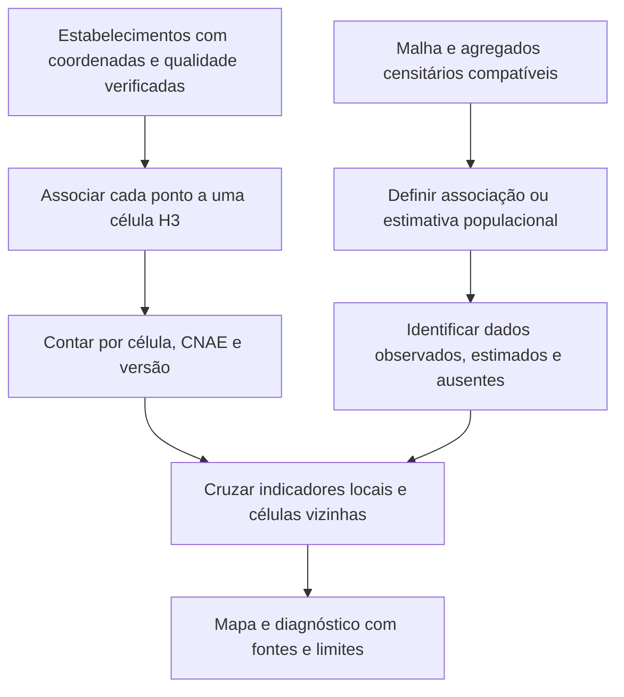

# Análise territorial com H3 — proposta de evolução

Registrado em 28/10/2026 a partir da ideia do usuário. **Em avaliação; não implementado nem aprovado como substituição do recorte municipal.** A experiência operacional relatada é inspiração, não uma fonte de dados integrada ou uma validação independente de eficácia.

## Objetivo no RightPoint

Identificar diferenças dentro de um município: concentração de estabelecimentos, população e características do público. H3 organiza localização e agregação em células; não fornece esses dados nem produz sozinho uma chance de sucesso comercial.

O sistema é aberto, sob Apache 2.0, e foi desenvolvido para necessidades da Uber. O uso pela 99 não foi verificado nesta avaliação e não deve ser apresentado como confirmado.

## Fluxo proposto

## O que precisamos antes

- **Estabelecimentos:** coordenadas confiáveis. A amostra atual não contém latitude/longitude. Endereço, nome do município ou centro de CEP não garantem localização do estabelecimento. Seleção de geocodificador, custo e condições de uso ficam a avaliar; guardar origem e qualidade de cada localização, sem inventar coordenadas.
- **População:** avaliar malha definitiva e agregados por setores censitários do Censo 2022, com edições compatíveis. A malha sozinha não fornece todos os indicadores. Não dividir a população municipal igualmente entre células.
- **Setores e células:** seus limites são diferentes. Repartição por interseção de área é estimativa e pressupõe distribuição espacial; não tratar como contagem observada. Escolher método, verificar conservação dos totais, ausências/supressões e erro antes de publicar população por célula.
- **Renda e público:** nem toda variável tem a mesma granularidade. Não atribuir renda municipal a cada célula como se fosse observação local.
- **Município/bairro:** manter códigos oficiais e polígonos como referência. Célula H3 pode cruzar limites administrativos; H3 complementa, não substitui bairro, rua ou município.

## Escala e bordas

Comparar no piloto as resoluções abaixo, sem decisão final de adoção:

| Resolução H3 | Área média global de hexágono | Papel a avaliar |
| --- | --- | --- |
| 8 | aproximadamente 0,737 km² | Visão de entorno mais ampla |
| 9 | aproximadamente 0,105 km² | Leitura mais localizada, se os dados suportarem |

São médias, não áreas exatas de cada célula. O H3 é predominantemente hexagonal e possui pentágonos. Mais resolução aumenta detalhe visual, não a precisão da fonte.

- A quantidade de células do município depende da resolução, polígono/edição e regra de borda. Não é um número fixo de toda a tecnologia.
- `polygonToCells` usa o centro da célula para decidir inclusão. Isso não equivale a todas as células que intersectam o município. Definir/testar cobertura de borda e recorte para exibição, sem perder pontos válidos ou duplicar estabelecimentos.
- Não inferir pertencimento administrativo somente pelo ID H3. Para limites exatos, validar coordenada contra polígono oficial; células de resoluções diferentes têm contenção lógica exata, mas não encaixe geométrico perfeito.
- Vizinhança H3 não equivale a distância por ruas, tempo de caminhada ou acesso: rios, vias e barreiras precisam de tratamento próprio se entrarem na análise.
- Persistência e biblioteca ainda a decidir: guardar identificador H3 como texto, resolução, versão e procedência dos dados; não introduzir novas tabelas, dependências ou servidor geoespacial nesta avaliação.

## Qualidade, segurança e interpretação

- Sem cobertura/localização suficiente: mostrar indisponibilidade, não célula vazia como ausência de concorrência. Publicar também a cobertura de geocodificação.
- Ausência de ocorrências registradas não prova segurança; considerar período, cobertura de registros e exposição antes de interpretar taxas. Não transferir regras de implantação de ativos diretamente para oportunidade comercial.
- KML/KMZ são formatos, não garantia de fonte confiável. Camadas externas exigem origem, data, licença, granularidade e avaliação de viés.
- Dados operacionais internos de segurança, ativos ou áreas de atuação de grupos não entram no escopo atual. Não solicitar, copiar, publicar ou integrar camadas internas sem finalidade e autorização específicas. Para o protótipo, usar dados públicos adequados ou exemplos sintéticos.
- Não atribuir risco a moradores/estabelecimentos apenas por proximidade geográfica nem produzir uma porcentagem de sucesso a partir dessa malha.

## Sequência de evolução proposta

1. Concluir diagnóstico municipal mínimo com contagem completa na fonte, população, datas e critérios aprovados.
2. Escolher um piloto territorial e avaliar cobertura de endereços/coordenadas e dados censitários intramunicipais.
3. Comparar duas resoluções com dados sintéticos ou públicos adequados, sem alterar o mapa atual de produção do protótipo.
4. Conferir pontos de borda, duplicatas, totais, incerteza populacional e desempenho; só então propor modelo e interface.
5. Aprovar regra de diagnóstico/score espacial antes de implementá-la, sem confundir score com probabilidade de sucesso.

## Referências consultadas

- [H3 — introdução, licença e origem](https://h3geo.org/docs/).
- [H3 — conversão entre coordenadas e células](https://h3geo.org/docs/api/indexing/).
- [H3 — estatísticas de áreas por resolução](https://h3geo.org/docs/core-library/restable/).
- [H3 — seleção de células por polígono](https://h3geo.org/docs/api/regions/).
- [H3 — hierarquia e limites geométricos](https://h3geo.org/docs/highlights/indexing/).
- [IBGE — malha de setores censitários](https://www.ibge.gov.br/geociencias/organizacao-do-territorio/malhas-territoriais/26565-malhas-de-setores-censitarios-divisoes-intramunicipais.html).
- [IBGE — Censo 2022 e agregados por setores](https://www.ibge.gov.br/estatisticas/Sociais/populacao/22827-censo-demografico-2022.html?edicao=40121).
